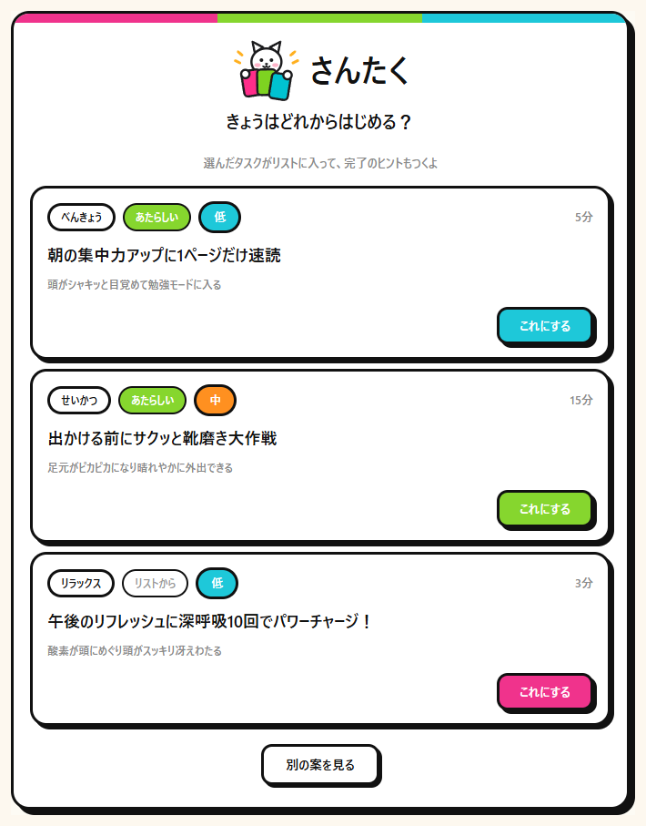
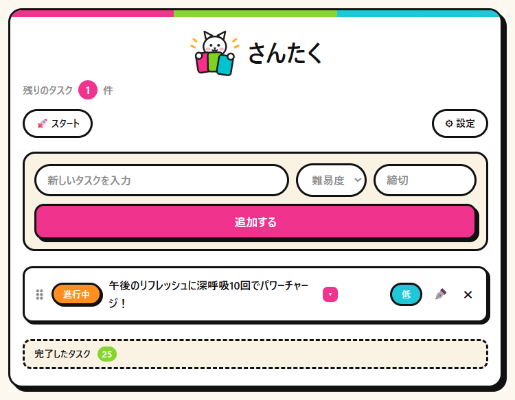

# さんたく

> 3つの案から、ひとつ選ぶだけ。

AI が3つのタスクを提案し、選ぶだけで実行できるタスク管理アプリです。
システム開発演習（20日間）の制作物。

利用者が行うのは「押す」と「選ぶ」の2つだけ。タスクを書き出す作業も、どれから手をつけるかの判断も要りません。

<p align="center">
  
</p>

---

## 何が解けるのか

タスク管理アプリが続かないのは、意志ではなく手順の問題だと考えました。

| つまずく場面 | さんたくでの解き方 |
|---|---|
| 何から手を付けるか決められない | AI が3案に絞る。選択肢が3つなら選べる |
| タスクが大きすぎて着手できない | 重さを分けて提案する（すぐ終わる／今日中に／まとまった時間） |
| どこまでやれば終わりか分からない | 提案と同時に「おわりの目安」を1行で生成する |
| 登録したまま忘れて溜まる | 3案のうち1つは、リストに残っているタスクから出す |
| 完了ボタンの押し忘れ | 着手と同時に完了を予約する「やっちゃう」 |

---

## 主な機能

- **Google ログイン**（OpenID Connect）。名前もメールアドレスも受け取らない
- **3案の提案**。分野と重さはアプリが決め、AI は文章だけを書く
- **タスク管理**。追加・編集・削除・並べ替え・状態の切り替え・締切・難易度
- **自動完了（やっちゃう）**。予約した時刻にサーバー側で完了にして通知する
- **ブラウザ通知**（Web Push）。毎朝8時の声かけ、締切、自動完了の知らせ
- **記録からの重み付け**。分野ごとの完了率を、次の提案の選ばれやすさに足す

<p align="center">
  
</p>

---

## 技術構成

| 区分 | 使ったもの |
|---|---|
| 言語・基盤 | Java 21 / Spring Boot 4.0.8 |
| 画面 | Thymeleaf / 素の JavaScript |
| データベース | MySQL 9.7（本番） / H2（開発・テスト） |
| 認証 | Spring Security + OAuth2 Client（Google） |
| 生成AI | Gemini Developer API `gemini-3.6-flash` |
| 通知 | Web Push（VAPID） |
| テスト | JUnit 5（6クラス・27件） |

JavaScript のフレームワークは入れていません。やることが並べ替え・削除・通知の購読だけなので、覚える量のほうが多くなるためです。

---

## 設計で決めたこと

**AI に任せる範囲を決める。**
どの分野を出すか、どのタスクを3件目に使うか、カード1枚の重さはアプリ側で決めます。AI が書くのは題名・選ぶ理由・完了のヒントだけ。返す形は `responseSchema` で固定しています。

**AI が落ちても止まらない。**
呼び出しに失敗したら、決まった3案に切り替えて画面は出します。どこから来た3案かを記録しているので、あとから失敗の割合を数えられます。

**AI を待っているあいだ、データベースの接続を握らない。**
応答を待つ3〜5秒のあいだ接続を持ったままにしないよう、書き込みだけを別クラス（`ProposalStore`）にまとめています。

**他人のデータに触れない入口を絞る。**
1件を取り出す処理を `TaskService.findById` / `ProposalService.findSet` / `findCard` の3つに限り、そこで持ち主を確かめます。他人のものを指定したときは、存在しないときと同じ 404 を返します。

---

## 動かす

必要なもの … Java 21 / Maven 3.9以降 / MySQL 8以降 / Google Chrome

```bash
# 1. データベースを作る
mysql -u root -p < docs/schema_mysql.sql

# 2. 環境変数を設定する（docs/env.sample.txt を参照）
#    GEMINI_API_KEY / GOOGLE_CLIENT_ID / GOOGLE_CLIENT_SECRET
#    VAPID_PUBLIC_KEY / VAPID_PRIVATE_KEY / DB_PASSWORD

# 3. 起動する
mvn spring-boot:run
```

MySQL が無くても、H2 で動かせます。

```bash
mvn spring-boot:run -Dspring-boot.run.profiles=dev
```

Gemini のキーが無いときは、`application.yml` の `ai.mock` を `true` にすると固定の3案で画面が一通り動きます。

詳しくは [docs/startup_guide.txt](docs/startup_guide.txt) を見てください。

---

## テスト

```bash
mvn test
```

6クラス27件。ロジックの17件は Spring を起動せずに動き、データベースを使う9件はメモリ上の H2 で走ります。本番のデータは触りません。

---

## 構成

```
src/main/java/com/example/taskboard
├── ai/          AI とのやりとり（プロンプト・呼び出し・失敗時の3案）
├── config/      認証・CSRF・鍵
├── controller/  画面の入口
├── domain/      テーブルに対応するクラス
├── dto/         画面用の入れ物
├── logic/       アプリ側の判断（分野と時間を決める）
├── repository/  データベースの出し入れ
└── service/     処理のまとまり
```

`ai/` が外との窓口で、Gemini を呼ぶのはこの中だけです。`logic/` は AI に任せない判断を置く場所で、分野と時間はここで決めてから AI に渡します。

---

## 資料

- [発表資料（PDF・20ページ）](docs/presentation.pdf) ── 何を作って、何を判断したか
- [起動手順](docs/startup_guide.txt)
- [DB定義](docs/schema_mysql.sql)
- [依存ライブラリ](docs/dependencies.md)

---

## 制限事項

- 1人での利用を前提にしています。同時に多数が使う場面は想定していません
- Gemini の無料枠には1日の上限があり、達すると固定の3案になります
- 通知は端末ごとに登録が要ります（Web Push の仕組み上）
- 画面はスマートフォンの幅に合わせていますが、タブレット向けの調整はしていません
- 退会・全データ削除は作っていません。持っているのは Google の識別子と本人が書いたタスクだけで、タスクは1件ずつ消せます